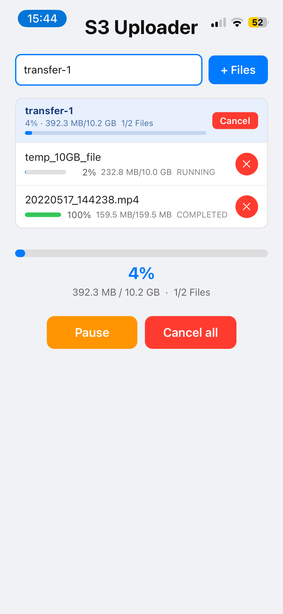
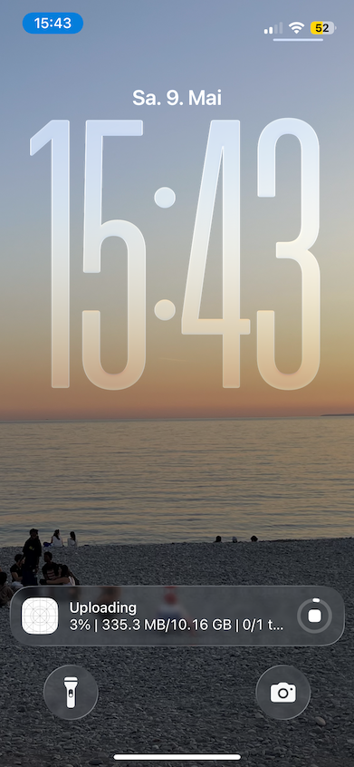

# react-native-s3-bg-uploader

[](https://www.npmjs.com/package/react-native-s3-bg-uploader)
[](https://www.npmjs.com/package/react-native-s3-bg-uploader)
[](https://github.com/nikwebr/react-native-s3-bg-uploader/LICENSE)

<strong>📖 [Read the Documentation](https://uploader.ysendit.com/docs)</strong>

Seamless file uploads that continue even when your app goes to background. Pausable, resumable, and built for the S3 API. 
react-native-s3-bg-uploader is a react native package built with Nitro and Rust. It is compiled to native modules on iOS and Android, and to WebAssembly for the web. On iOS it uses a BGContinuedProcessingTask and on Android a foreground service.

<p float="left">
  
  
</p>


## Requirements

- React Native v0.76.0 or higher
- Node 18.0.0 or higher

### iOS
- background uploading is only supported for iOS 26 or later
- enabled "background fetch" & "background processing" capabilities
- registered BGTaskSchedulerPermittedIdentifiers of value $(PRODUCT_BUNDLE_IDENTIFIER).background inside info.plist

## Installation

```bash
npm install react-native-s3-bg-uploader react-native-nitro-modules
```

## Usage

```ts
import { S3BgUploader } from 'react-native-s3-bg-uploader'

// Configure backend endpoints once (e.g. in app startup)
S3BgUploader.setConfig(
  'https://api.example.com/upload/startUpload',
  'https://api.example.com/upload/getUploadUrls',
  'https://api.example.com/upload/completeUpload',
)

// Track progress
S3BgUploader.setProgressCallback((file, session, transfer) => {
  console.log(`${transfer.percentage}% — ${file.fileName}`)
})

// Enqueue files and start
const transferId = 'my-transfer'
await S3BgUploader.uploadFile(
  '/path/to/file.mp4', transferId, { userId: '42' }
)
await S3BgUploader.encryptAndUploadFile(
  '/path/to/file2.mp4',
  'my-encrypted-transfer',
  keyHex,   // 32-byte key as 64 hex characters
  nonceHex, // 24-byte base nonce as 48 hex characters
  { userId: '42' }
)
await S3BgUploader.resume()

// Pause / resume / cancel
S3BgUploader.pause()
await S3BgUploader.resume()
S3BgUploader.cancel()
```

For the full API reference see the [documentation](https://uploader.ysendit.com/docs).

## Building
For native platforms:
```bash
npm run build:ios
npm run build:android
```

For web:
```bash
npm run build:wasm
```

### Additional requirements
- [rustup](https://rust-lang.org/tools/install/)
- **iOS**: Xcode with Command Line Tools (`xcode-select --install`)
- **Android**: Android SDK with NDK — set `ANDROID_NDK_HOME` or `ANDROID_NDK_ROOT`, install [cargo-ndk](https://github.com/bbqsrc/cargo-ndk) (`cargo install cargo-ndk`)

### Running the Example App
```bash
npm install
npm run example:ios
npm run example:android
npm run example:web
```

> [!IMPORTANT]  
> Background uploads on iOS only work on a physical device as the simulator does not support the BGContinuedProcessingTask API.

> [!IMPORTANT]  
> Please do not upload confidential files. The example app is connected to a demo s3 bucket. Files are only deleted irregularly from this bucket.

### Production Builds
#### Android
Follow the instructions [here](https://reactnative.dev/docs/signed-apk-android#generating-an-upload-key) to generate an upload key and to set required gradle variables.

After that:
```bash
cd example
npm run android -- --mode="release"
```

#### iOS
Change build configuration to production inside XCode: Open S3BackgroundUploaderExample.xcworkspace and edit the scheme.

## End to end encryption

### Default algorithm

`encryptAndUploadFile()` uses **XChaCha20-Poly1305** by default: the XChaCha20
stream cipher provides confidentiality, and a Poly1305 authentication tag detects
tampering with each chunk. Encryption runs locally before any file content is
uploaded, on iOS, Android, and web, without registering a custom encryptor.
Plain `uploadFile()` remains unencrypted.

The built-in cipher takes a 32-byte key and a 24-byte base nonce, supplied as hex
strings with each upload. It derives a deterministic nonce for each part and
authenticates the part number, allowing individual parts to be retried or resumed
while detecting reordering. An authenticated descriptor appended to the final
part records the chunk layout and total data-part count for decryption.

For end-to-end encryption, your app must manage keys and deliver them securely to
the intended recipient without exposing them to the upload backend or storage
provider. The uploader encrypts uploads; it does not manage key exchange or
automatically decrypt downloaded objects.

### Sizes and hashes for encrypted uploads

Encryption changes the size of the object that is stored, so the uploader reports
wire sizes rather than local file sizes:

- `fileHash` is always computed over the **unencrypted** file, so duplicate
detection and resume behave exactly the same for `uploadFile()` and
`encryptAndUploadFile()`. `setConfig(startUploadApi, getUploadUrlsApi,
completeApi, sendFileHash)` defaults to `true`; pass `false` to keep the hash
local and omit it from the `startUpload()` request body.
- `startUpload()` always receives the size of the **local, unencrypted** file as
`fileSize`, so the backend never has to treat an estimated number as the real
file size. For `encryptAndUploadFile()` the body also carries an `encryption`
object with the format numbers the backend needs to derive the stored size (see
below).
- Progress callbacks report `totalBytes` and `uploadedBytes` in bytes of the
uploaded object, and `percentage` relative to it. For encrypted uploads that is
the real ciphertext size, so a paused or resumed upload reports the same totals
as a completed one.
- `uploadedBytes` counts only parts the backend has acknowledged with an ETag, so
`percentage` reaches `100` only once every part is stored (the `COMPLETED` state
follows immediately). A part whose body reached the server but whose response
was lost has no ETag yet and is retried; its bytes are not counted, which means a
dropped connection can neither show `100%` early nor make the bar drop when it
reconnects. A paused snapshot also reports committed parts only.

The `encryption` object looks like this:

```json
{
  "fileName": "video.mp4",
  "fileHash": "…",
  "fileSize": 31457280,
  "encryption": { "overhead": 16, "hasFooter": true, "footerLen": 28 }
}
```

The backend already chooses `partSize`, so although the exact ciphertext size is
only known after that choice, the backend can compute it itself — the client does
not send an estimate:

```text
reserved     = overhead + (hasFooter ? footerLen : 0)  // reserved in every part
effective    = partSize - reserved                     // plaintext bytes per part
dataParts    = ceil(fileSize / effective)              // at least 1 if hasFooter
storedBytes  = fileSize + overhead * dataParts + (hasFooter ? footerLen : 0)
```

Custom encryptors declare the same three numbers through the vtable
(`ciphertext_overhead`, `has_footer`, `footer_len`), so a backend sizes them with
the same formula. This relies on what the chunk engine already requires: a
constant number of extra bytes per part and a descriptor of fixed length. A
scheme whose ciphertext length is not a fixed function of the plaintext length
(compression, padding to a data-dependent boundary, a descriptor whose length
depends on the data) cannot be sized this way — and is not supported by the
chunk engine either.

### Custom encryptors

A host app can plug in its own chunk-encryption scheme without rebuilding this package, by
registering an `EncryptorVTable` (see `uploader/src/core/encryption.rs` and the generated
`ios/rust/uploader.h`). The uploader reads every field unconditionally:

| field | meaning |
|---|---|
| `create(key, key_len, nonce, nonce_len)` | build the encryptor for **one upload** from the key material of that `encryptAndUploadFile(...)` call. Return `NULL` to fall back to the built-in cipher for that upload |
| `encrypt_chunk(ctx, input, input_len, part_number)` | encrypt one S3 part and return a heap allocation in an `EncryptResult` |
| `free(ctx, data, len, capacity)` | release a result — the uploader copies the bytes out first, so the host may allocate however it likes |
| `destroy(ctx)` | release a context built by `create` — exactly once per upload, when the file's session entry is dropped (finished, cancelled or evicted) |
| `ciphertext_overhead` | bytes your scheme adds per chunk (tag, IV prefix, …); the engine reads `part_size - overhead` plaintext per part so the ciphertext fills the URL slot exactly. Use `0` for a stream cipher |
| `has_footer` | `true` if the wire format ends with a synthesised descriptor, appended to the last data part |
| `footer_len` | bytes that descriptor occupies; the engine reserves them in every part so the final part still fits its URL slot. Must be non-zero when `has_footer` is `true` |
| `compute_footer(ctx, n_data_parts, effective_part_size)` | builds that descriptor; only called when `has_footer` is `true` (Rust hosts use `no_descriptor` when it is `false`, C/C++/Swift hosts may pass `NULL`) |

The descriptor is **never an S3 part of its own** — it is appended to the final data part. S3
requires every part except the last to be at least 5 MiB, so a tiny trailing part would demote
the real last part to an intermediate one and `CompleteMultipartUpload` would fail with
`EntityTooSmall` for every file whose final part is below that minimum (which is most files).
Riding inside the last part keeps that part last, where any size is allowed.

Anything that works part-by-part is expressible: an AEAD tag (`overhead` = tag size), an IV
prefix (`overhead` = IV size), a stream cipher (`overhead = 0`), with or without a descriptor.
With `has_footer = false`, `footer_len` is `0`, `compute_footer` is never called and the engine
reserves nothing extra.

Register the factory once at startup from native code. No key material is passed there —
only the table:

```swift
CustomEncryptor.register()                                   // iOS / Swift
HybridS3BgUploader.registerCustomEncryptor(vtablePointer)    // Android / Kotlin
S3BgUploader.registerCustomEncryptor(vtablePointer)          // JS, if you prefer to register late
```

Every encrypted upload then supplies **its own** key and nonce:

```ts
await S3BgUploader.encryptAndUploadFile(path, transferId, keyHex, nonceHex)
```

The uploader decodes those hex strings and calls `create`, which builds one encryptor instance
per file. That means:

- two uploads in flight at the same time may use different keys (no global key state);
- new uploads are marked encrypted before they become schedulable or are first persisted,
  so they cannot temporarily run as plaintext during initialization;
- the instance is stored with that file's session entry, so pause/resume re-encrypts with the
  same key while the process remains alive. Keys and encryptor instances are not persisted:
  after a restart, re-provide encrypted files with `encryptAndUploadFile()` and the original
  key/nonce. Plain `uploadFile()` reprovisioning and background uploads without the required
  encryption configuration fail instead of sending plaintext;
- a scheme that keeps its key on the device (Keychain / Keystore) may ignore the bytes and
  return a context anyway. Returning `NULL` instead makes the uploader use its built-in
  XChaCha20-Poly1305 for that upload.

Plain `uploadFile(...)` stays plaintext.

#### Web

A browser has no second binary, so the mechanism is JavaScript running in the uploader's worker,
registered as a factory with the same per-upload contract:

```ts
await S3BgUploader.registerWebEncryptor({
  source: myFactory.toString(),   // (key: Uint8Array, nonce: Uint8Array) => { encryptChunk, computeFooter? }
  overhead: 16,
  hasFooter: true,
  footerLen: 28,
});

await S3BgUploader.encryptAndUploadFile(file, transferId, keyHex, nonceHex);
```

The factory is called **once per upload** with that upload's decoded key/nonce, and the instance it
returns encrypts that file only — so a browser build has the same per-upload key semantics as the
native vtable's `create`. Return `null` to fall back to the built-in cipher for that upload. The
callbacks may return Promises (`crypto.subtle` is async).

#### What the ABI cannot express

`encrypt_chunk` is called once per S3 part with that part's plaintext only. The engine never
hands over the whole file: it seeks to `(part_number - 1) * part_size`, reads that one part,
and keeps at most a few parts in flight. The descriptor callback sees only `n_data_parts` and
`effective_part_size` — never the data.

So a scheme that needs a **single pass over the whole file** cannot be expressed:

- block chaining across parts (e.g. CBC/CTR state carried from part to part),
- a global trailer or digest computed over the entire plaintext,
- anything that needs the complete ciphertext before it can emit a part.

That part-independence is deliberate: every part must be re-encryptable from
`key + base_nonce + part_number` alone, which is what makes pause/resume cheap and
deterministic — a scheme carrying global state has no way to resume or retry a single part.

A worked example that also shows the linking model (the host crate must **not** depend on the
`uploader` crate — it imports `register_custom_encryptor` so the framework stays the single
copy of the uploader) lives at `custom-encryption-example/` (AES-256-GCM, descriptor in the
final part), together with `tools/decrypt` — a standalone verifier that decodes an uploaded object
from the wire format and reports which encryptor produced it.

## Troubleshooting
### ReferenceError: Can't find variable: wasm_bindgen
Run in the root of the repo
```bash
npm run build:rust:wasm
```

## Credits

Bootstrapped with [create-nitro-module](https://github.com/patrickkabwe/create-nitro-module).

## Contributing

Pull requests are welcome. For major changes, please open an issue first to discuss what you would like to change.

### End-to-end tests

The iOS, Android, and web build workflows run **Maestro 2.12.0** on every pull
request and manual workflow run. Each platform uploads a plaintext fixture and
an XChaCha20-Poly1305-encrypted fixture, pauses after a completed multipart
chunk, lets already-sent parts settle, checks that progress stays unchanged
while paused, resumes the same multipart upload without re-requesting the
first chunk, and downloads both
objects. The independent Python oracle checks exact plaintext bytes, ciphertext
size and absence of plaintext, correct-key decryption back to the original
bytes, and rejection of a wrong key.
Both upload modes must report `COMPLETED` within **20 seconds of the first
100% progress callback**. The shared test uses a monotonic clock and a watchdog;
later progress drops do not reset the deadline. The elapsed time is saved as
`completedAfter100PercentMs` in the verification artifacts.
`100%` means every part has been acknowledged by the backend, so the same run
also checks the contract that produced the bug report: after the pause it drops
one presigned part `PUT` **after the whole body arrived** (a link that dies before
the response), which the uploader has to retry. The test app records every
progress callback, and the backend rejects the run if a running upload ever
reported fewer bytes than an earlier callback (`progressRegressions`, including
across the pause and resume) or reported `100%` while parts were still
unacknowledged (`prematureHundreds`). It also requires evidence that the dropped
part was retried (`networkErrorRetried`), so a silent fallback cannot pass.

Tests use a local Moto S3-compatible HTTP server and synthetic 31 MiB fixtures;
no AWS credentials, external demo bucket, or Maestro Cloud subscription are
needed. Encryption and uploading run through the real native/Rust or WASM
implementation, not a mocked uploader. The server releases its blocked PUTs
**while the uploader is paused**, so the gate cannot hide a broken pause.
Downloads and decryption are verified on the host through the S3 HTTP API and
`scripts/decrypt.py`; the package does not provide a download/decrypt API.
The iOS simulator covers foreground uploads, not device-only background tasks.

Install Node dependencies and the test tools (Python 3.10+ and Java 17+):

```bash
npm install
python3 -m venv e2e/.venv
e2e/.venv/bin/pip install -r e2e/requirements.txt
bash e2e/install-maestro.sh
```

For web:

```bash
npm run build:wasm
cd example && E2E=1 npx webpack --mode production && cd ..
bash e2e/run.sh web
```

For Android, build the normal debug example after `npm run build:android`, boot
an emulator, then run `bash e2e/run.sh android`. For iOS, build the Debug simulator
example after `npm run build:ios` and installing Pods, boot that simulator, then
run `bash e2e/run.sh ios`. Set `E2E_DEVICE` to a simulator UDID or Android serial
to select a specific device, and `E2E_APP` to use a non-default `.app`/APK path.
The runner installs the example app, copies the fixture into its sandbox, starts
Metro with the test-only entry (`E2E=1`), and cleans up its servers on exit.
Android runs clear **only the example app's data**; use a dedicated test emulator.
Ports 8080, 8765, and 9000 must be free.
The native tests route React Native's default Metro port to the isolated test
server on 8080 (an iOS launch argument and Android ADB reverse with an explicit
app-local debug host), leaving any development server on the host's port 8081
untouched.
The iOS workflow allows up to ten minutes for Maestro's XCTest driver to start
on a cold hosted simulator (`MAESTRO_DRIVER_STARTUP_TIMEOUT=600000`, in
milliseconds). This does not increase flow or upload assertion timeouts.
Before launching either iOS example, the runner requests its test bundle from
Metro with a separate ten-minute preparation limit. This keeps cold JavaScript
bundling outside the screen-readiness wait; failures stop the run explicitly.
Preparation timing is retained in `metro-warmup.log`.
The iOS workflow also runs a native regression that pauses or replaces an upload
while its old network worker is blocked. The upload queue must return promptly
and allow a resumed run to finish without waiting for that old request.
It also checks that native end-of-stream events expose `AtEnd` to their delegate,
not the `Open` fallback produced when the stream buffer is still locked, and
that EOF is delivered after the last buffered bytes are consumed.
The test screen also reads current progress after obtaining the upload key, so a
fast first-part callback emitted before the start call resolves is not lost.
The pause check waits for progress to stop changing instead of sleeping a fixed
time, because parts already in flight may finish after a pause and a slow runner
would otherwise report those permitted completions as progress made while
paused. Set `E2E_RELEASE_STAGGER_MS=1000` to make the backend answer those
in-flight parts seconds apart and reproduce that timing locally.

The same workflows also test `custom-encryption-example` with both plaintext and
custom AES-256-GCM uploads. Add `custom` as the runner's second argument
(`bash e2e/run.sh web custom`, `android custom`, or `ios custom`).
Its independent verifier requires AES-GCM explicitly, so a built-in-encryptor
fallback cannot pass. See the [custom example's E2E setup](custom-encryption-example/README.md#end-to-end-tests)
for its additional encryptor/app builds and separate artifacts.

Screenshots, JUnit results, backend logs, downloaded files, and decryption
evidence are retained in `e2e/artifacts/<platform>/` and uploaded as pipeline
artifacts even on failure. Build the independent Rust verifier, then run the
oracle's positive and negative contract tests for both encryption schemes:

```bash
cargo build --release --locked --manifest-path custom-encryption-example/tools/decrypt/Cargo.toml
e2e/.venv/bin/python -m unittest discover -s e2e -p 'test_*.py'
```